# Design Patterns Masterclass: Creational, Structural & Behavioral

## Introduction

Design patterns are reusable solutions to commonly occurring problems in software design. They represent best practices and provide a shared vocabulary for developers. This session covers the three main categories of design patterns with practical examples, visual diagrams, and real-world applications.

## Design Patterns Landscape

### Total Pattern Count
The original "Gang of Four" (GoF) book documented **23 fundamental design patterns**, but the pattern community has identified many more:


### Pattern Categories Beyond GoF

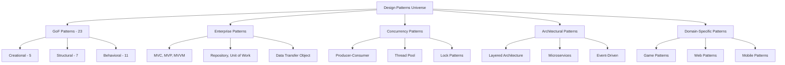

### Complete GoF Pattern List

| Category | Pattern | Frequency of Use | Complexity |
|----------|---------|------------------|------------|
| **Creational (5)** | Singleton | ⭐⭐⭐⭐⭐ | Low |
| | Factory Method | ⭐⭐⭐⭐⭐ | Medium |
| | Abstract Factory | ⭐⭐⭐ | High |
| | Builder | ⭐⭐⭐⭐ | Medium |
| | Prototype | ⭐⭐ | Medium |
| **Structural (7)** | Adapter | ⭐⭐⭐⭐⭐ | Low |
| | Bridge | ⭐⭐ | High |
| | Composite | ⭐⭐⭐ | Medium |
| | Decorator | ⭐⭐⭐⭐ | Medium |
| | Facade | ⭐⭐⭐⭐⭐ | Low |
| | Flyweight | ⭐⭐ | High |
| | Proxy | ⭐⭐⭐ | Medium |
| **Behavioral (11)** | Observer | ⭐⭐⭐⭐⭐ | Medium |
| | Strategy | ⭐⭐⭐⭐⭐ | Low |
| | Command | ⭐⭐⭐⭐ | Medium |
| | State | ⭐⭐⭐ | Medium |
| | Template Method | ⭐⭐⭐ | Low |
| | Chain of Responsibility | ⭐⭐ | Medium |
| | Iterator | ⭐⭐⭐⭐ | Low |
| | Mediator | ⭐⭐ | High |
| | Memento | ⭐⭐ | Medium |
| | Visitor | ⭐ | High |
| | Interpreter | ⭐ | High |

## Pattern Categories Overview

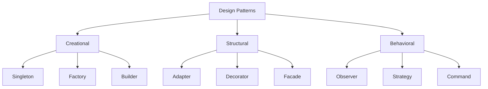

---

## Part 1: Creational Design Patterns

**Purpose**: Deal with object creation mechanisms, trying to create objects in a manner suitable to the situation.

### 1.1 Singleton Pattern

**Intuition**: Ensures a class has only one instance and provides global access to it.

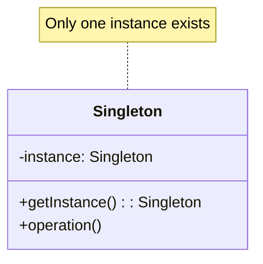

**✅ When to Use**:
- Database connection pools (expensive to create multiple)
- Logging services (centralized logging)
- Configuration managers (single source of truth)
- Cache implementations (shared memory space)
- Device drivers (hardware access control)

**Code Example**:
```python
class DatabaseConnection:
    _instance = None
    _lock = threading.Lock()
    
    def __new__(cls):
        if cls._instance is None:
            with cls._lock:
                if cls._instance is None:
                    cls._instance = super().__new__(cls)
                    cls._instance.connection = None
        return cls._instance
    
    def connect(self):
        if self.connection is None:
            self.connection = "Connected to Database"
            print("Database connection established")
        return self.connection

# Usage
db1 = DatabaseConnection()
db2 = DatabaseConnection()
print(db1 is db2)  # True - Same instance
```

### 1.2 Factory Pattern

**Intuition**: Creates objects without specifying their exact class. Like a car factory that can produce different car models based on specifications.

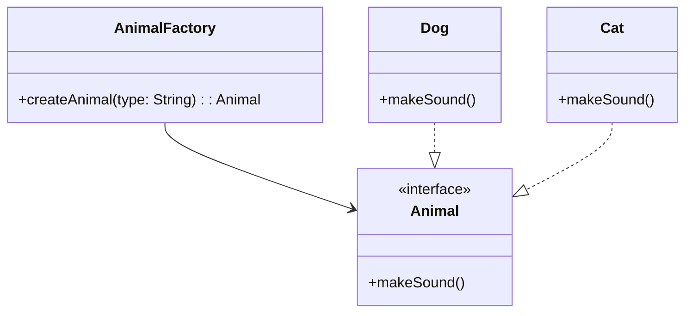

**✅ When to Use**:
- When you don't know which exact class to instantiate until runtime
- When creation logic is complex and centralized
- When you want to decouple object creation from usage
- When you have a family of related products
- When you need to enforce creation constraints

**Code Example**:
```python
from abc import ABC, abstractmethod

class Animal(ABC):
    @abstractmethod
    def make_sound(self):
        pass

class Dog(Animal):
    def make_sound(self):
        return "Woof!"

class Cat(Animal):
    def make_sound(self):
        return "Meow!"

class AnimalFactory:
    @staticmethod
    def create_animal(animal_type):
        if animal_type.lower() == "dog":
            return Dog()
        elif animal_type.lower() == "cat":
            return Cat()
        else:
            raise ValueError(f"Unknown animal type: {animal_type}")

# Usage
factory = AnimalFactory()
dog = factory.create_animal("dog")
cat = factory.create_animal("cat")
print(dog.make_sound())  # Woof!
print(cat.make_sound())  # Meow!
```
- **Realworld Example** : The Factory Pattern is often used in GUI frameworks where different button types (e.g., WindowsButton, MacButton) can be created based on the operating system.
---
### 1.3 Builder Pattern

**Intuition**: Constructs complex objects step by step. Like building a house where you can choose different options for rooms, materials, etc.

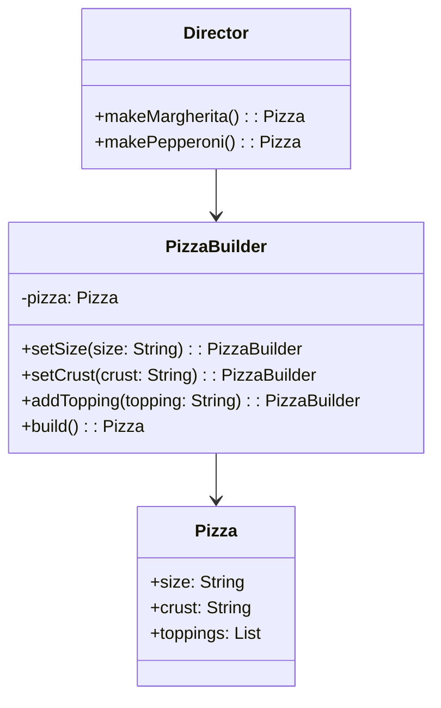

**✅ When to Use**:
- Creating objects with many optional parameters (>4-5 parameters)
- When constructor would have too many parameters
- When you want to create different representations of the same object
- When the construction process is complex and multi-step
- When you need immutable objects with many fields


**Code Example**:
```python
class Pizza:
    def __init__(self):
        self.size = None
        self.crust = None
        self.toppings = []
    
    def __str__(self):
        return f"{self.size} {self.crust} pizza with {', '.join(self.toppings)}"

class PizzaBuilder:
    def __init__(self):
        self.pizza = Pizza()
    
    def set_size(self, size):
        self.pizza.size = size
        return self
    
    def set_crust(self, crust):
        self.pizza.crust = crust
        return self
    
    def add_topping(self, topping):
        self.pizza.toppings.append(topping)
        return self
    
    def build(self):
        return self.pizza

# Usage
pizza = (PizzaBuilder()
         .set_size("Large")
         .set_crust("Thin")
         .add_topping("Pepperoni")
         .add_topping("Mushrooms")
         .build())

print(pizza)  # Large Thin pizza with Pepperoni, Mushrooms
```

---

## Part 2: Structural Design Patterns

**Purpose**: Deal with object composition and relationships between entities.

### 2.1 Adapter Pattern

**Intuition**: Allows incompatible interfaces to work together. Like a power adapter that lets you plug your device into different outlet types.

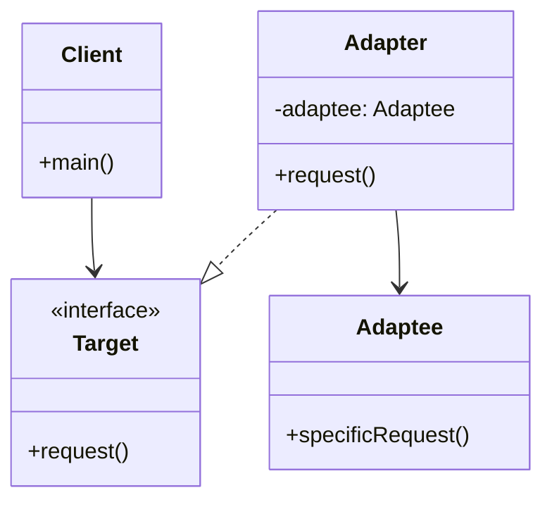

**✅ When to Use**:
- Integrating third-party libraries with different interfaces
- Legacy code integration without modification
- Making incompatible classes work together
- When you can't modify existing classes
- Creating reusable classes that work with unrelated classes

**Code Example**:
```python
# Old system
class OldPrinter:
    def old_print(self, text):
        return f"Old printer: {text}"

# New interface expected by client
class ModernPrinter:
    def print(self, text):
        return f"Modern printer: {text}"

# Adapter to make old printer work with new interface
class PrinterAdapter:
    def __init__(self, old_printer):
        self.old_printer = old_printer
    
    def print(self, text):
        return self.old_printer.old_print(text)

# Client code
def client_code(printer):
    return printer.print("Hello World")

# Usage
old_printer = OldPrinter()
adapter = PrinterAdapter(old_printer)
modern_printer = ModernPrinter()

print(client_code(adapter))        # Old printer: Hello World
print(client_code(modern_printer)) # Modern printer: Hello World
```

### 2.2 Decorator Pattern

**Intuition**: Adds new functionality to objects dynamically without altering their structure. Like adding accessories to a phone case.

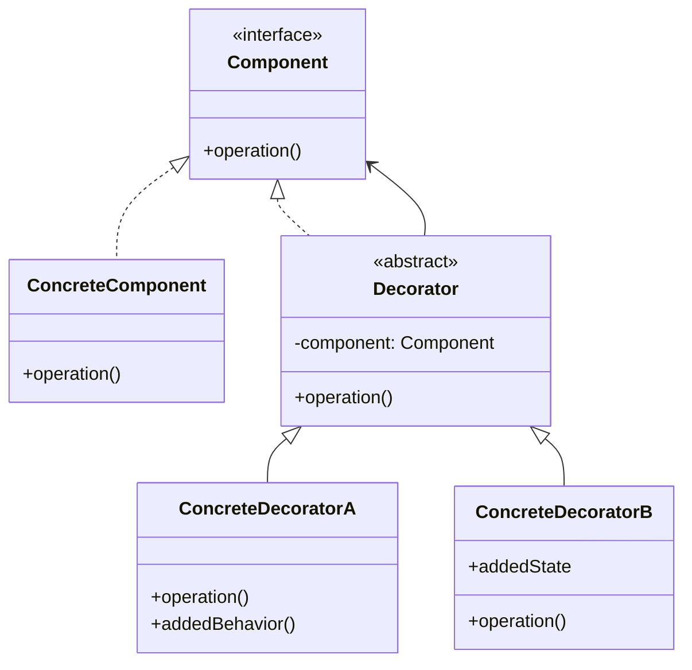

**✅ When to Use**:
- Adding responsibilities to objects dynamically at runtime
- When subclassing would result in an explosion of classes
- Extending functionality without modifying existing code
- When you need different combinations of behaviors
- Creating configurable object behavior


**Code Example**:
```python
from abc import ABC, abstractmethod

class Coffee(ABC):
    @abstractmethod
    def cost(self):
        pass
    
    @abstractmethod
    def description(self):
        pass

class SimpleCoffee(Coffee):
    def cost(self):
        return 2.0
    
    def description(self):
        return "Simple coffee"

class CoffeeDecorator(Coffee):
    def __init__(self, coffee):
        self._coffee = coffee
    
    def cost(self):
        return self._coffee.cost()
    
    def description(self):
        return self._coffee.description()

class Milk(CoffeeDecorator):
    def cost(self):
        return self._coffee.cost() + 0.5
    
    def description(self):
        return self._coffee.description() + ", milk"

class Sugar(CoffeeDecorator):
    def cost(self):
        return self._coffee.cost() + 0.2
    
    def description(self):
        return self._coffee.description() + ", sugar"

# Usage
coffee = SimpleCoffee()
coffee_with_milk = Milk(coffee)
coffee_with_milk_and_sugar = Sugar(coffee_with_milk)

print(f"{coffee_with_milk_and_sugar.description()}: ${coffee_with_milk_and_sugar.cost()}")
# Output: Simple coffee, milk, sugar: $2.7
```

### 2.3 Facade Pattern

**Intuition**: Provides a simplified interface to a complex subsystem. Like a TV remote that hides the complexity of the TV's internal systems.

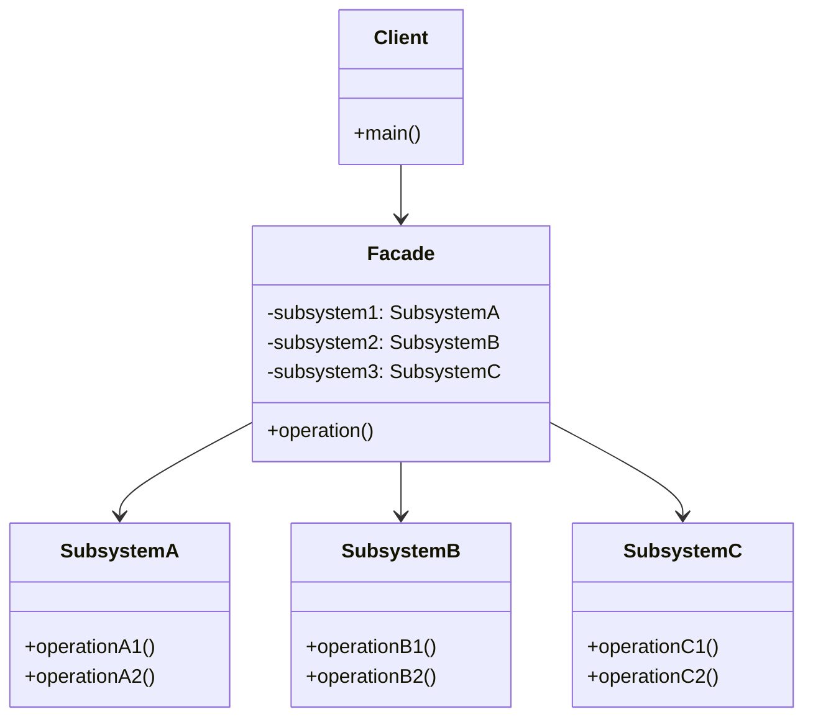

**✅ When to Use**:
- Simplifying complex APIs or subsystems
- Providing a unified interface to a set of interfaces
- Decoupling clients from complex subsystems
- Creating layers of abstraction
- When you want to hide implementation details


**Code Example**:
```python
# Complex subsystems
class DVDPlayer:
    def on(self):
        return "DVD Player is on"
    
    def play(self, movie):
        return f"Playing '{movie}'"
    
    def off(self):
        return "DVD Player is off"

class SoundSystem:
    def on(self):
        return "Sound System is on"
    
    def set_volume(self, level):
        return f"Volume set to {level}"
    
    def off(self):
        return "Sound System is off"

class Projector:
    def on(self):
        return "Projector is on"
    
    def wide_screen_mode(self):
        return "Projector in widescreen mode"
    
    def off(self):
        return "Projector is off"

# Facade
class HomeTheaterFacade:
    def __init__(self):
        self.dvd = DVDPlayer()
        self.sound = SoundSystem()
        self.projector = Projector()
    
    def watch_movie(self, movie):
        actions = [
            self.projector.on(),
            self.projector.wide_screen_mode(),
            self.sound.on(),
            self.sound.set_volume(5),
            self.dvd.on(),
            self.dvd.play(movie)
        ]
        return actions
    
    def end_movie(self):
        actions = [
            self.dvd.off(),
            self.sound.off(),
            self.projector.off()
        ]
        return actions

# Usage
theater = HomeTheaterFacade()
print("Starting movie:")
for action in theater.watch_movie("The Matrix"):
    print(f"  - {action}")
```

---

## Part 3: Behavioral Design Patterns

**Purpose**: Focus on communication between objects and the assignment of responsibilities.

### 3.1 Observer Pattern

**Intuition**: Defines a one-to-many dependency so that when one object changes state, all dependents are notified. Like a newsletter subscription system.

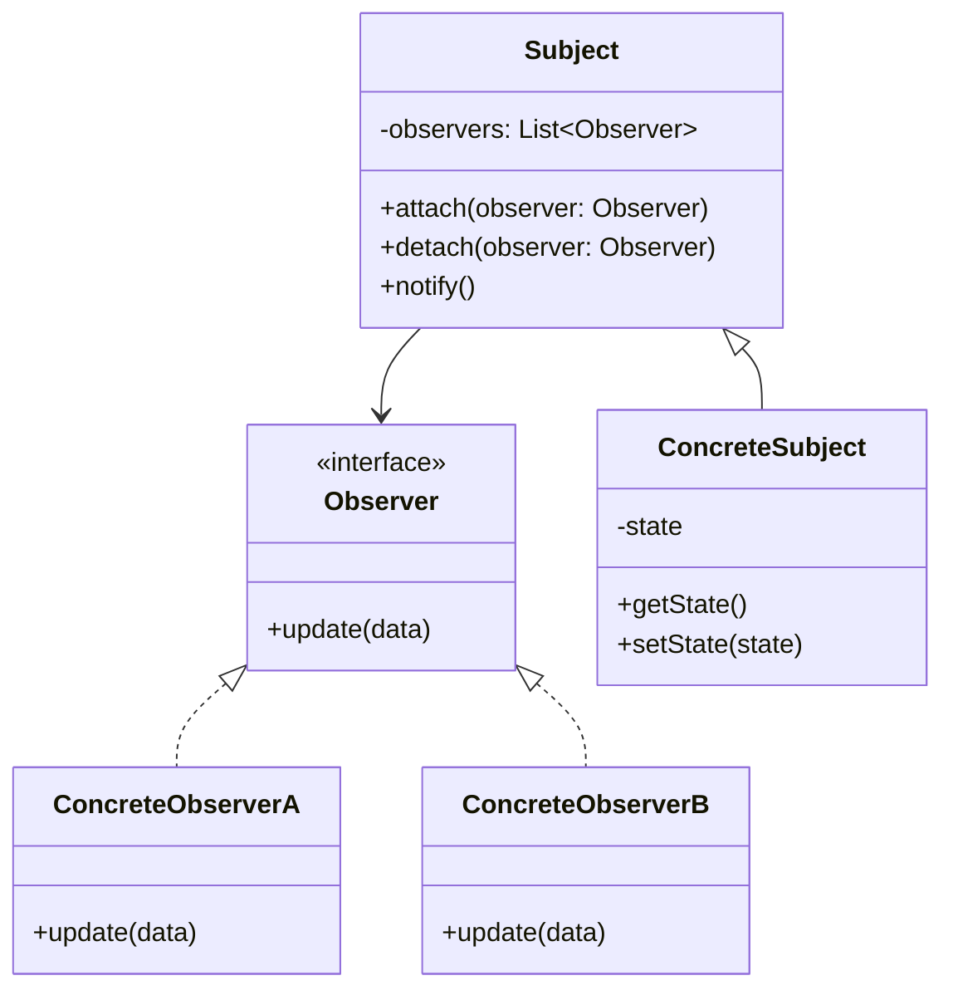

**✅ When to Use**:
- Event handling systems (GUI, user interactions)
- Model-View architectures (MVC, MVP, MVVM)
- When changes to one object require updating multiple objects
- Implementing distributed event handling
- Real-time data updates (stock prices, news feeds)


**Code Example**:
```python
from abc import ABC, abstractmethod

class Observer(ABC):
    @abstractmethod
    def update(self, message):
        pass

class Subject:
    def __init__(self):
        self._observers = []
    
    def attach(self, observer):
        self._observers.append(observer)
    
    def detach(self, observer):
        self._observers.remove(observer)
    
    def notify(self, message):
        for observer in self._observers:
            observer.update(message)

class WeatherStation(Subject):
    def __init__(self):
        super().__init__()
        self._temperature = 0
    
    @property
    def temperature(self):
        return self._temperature
    
    @temperature.setter
    def temperature(self, temp):
        self._temperature = temp
        self.notify(f"Temperature changed to {temp}°C")

class Display(Observer):
    def __init__(self, name):
        self.name = name
    
    def update(self, message):
        print(f"{self.name} received: {message}")

# Usage
weather_station = WeatherStation()
phone_display = Display("Phone")
computer_display = Display("Computer")

weather_station.attach(phone_display)
weather_station.attach(computer_display)

weather_station.temperature = 25  # Both displays get notified
weather_station.temperature = 30  # Both displays get notified again
```

### 3.2 Strategy Pattern

**Intuition**: Defines a family of algorithms, encapsulates each one, and makes them interchangeable. Like choosing different routes to reach the same destination.

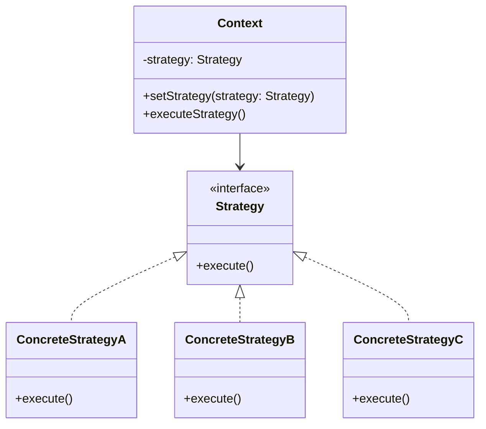

**✅ When to Use**:
- Multiple ways to perform the same task
- Avoiding large conditional statements for algorithm selection
- Runtime algorithm switching based on conditions
- When algorithms have different performance characteristics
- Plugin architectures where behavior can be swapped


**Code Example**:
```python
from abc import ABC, abstractmethod

class PaymentStrategy(ABC):
    @abstractmethod
    def pay(self, amount):
        pass

class CreditCardPayment(PaymentStrategy):
    def __init__(self, card_number):
        self.card_number = card_number
    
    def pay(self, amount):
        return f"Paid ${amount} using Credit Card ending in {self.card_number[-4:]}"

class PayPalPayment(PaymentStrategy):
    def __init__(self, email):
        self.email = email
    
    def pay(self, amount):
        return f"Paid ${amount} using PayPal account {self.email}"

class CryptoPayment(PaymentStrategy):
    def __init__(self, wallet_address):
        self.wallet_address = wallet_address
    
    def pay(self, amount):
        return f"Paid ${amount} using Crypto wallet {self.wallet_address[:8]}..."

class ShoppingCart:
    def __init__(self):
        self.items = []
        self.payment_strategy = None
    
    def add_item(self, item, price):
        self.items.append((item, price))
    
    def set_payment_strategy(self, strategy):
        self.payment_strategy = strategy
    
    def checkout(self):
        total = sum(price for item, price in self.items)
        if self.payment_strategy:
            return self.payment_strategy.pay(total)
        return "No payment method selected"

# Usage
cart = ShoppingCart()
cart.add_item("Laptop", 1000)
cart.add_item("Mouse", 25)

# Try different payment strategies
credit_card = CreditCardPayment("1234567890123456")
paypal = PayPalPayment("user@example.com")

cart.set_payment_strategy(credit_card)
print(cart.checkout())  # Paid $1025 using Credit Card ending in 3456

cart.set_payment_strategy(paypal)
print(cart.checkout())  # Paid $1025 using PayPal account user@example.com
```

### 3.3 Command Pattern

**Intuition**: Encapsulates a request as an object, allowing you to parameterize clients with different requests, queue operations, and support undo. Like a remote control with different buttons.

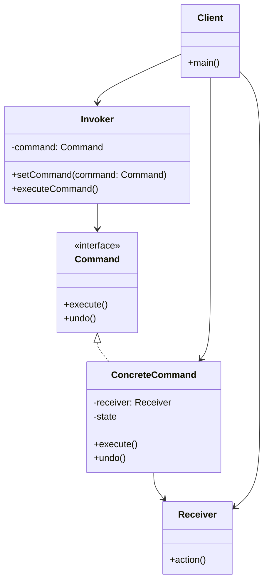

**✅ When to Use**:
- Undo/Redo functionality in applications
- Queuing operations for later execution
- Logging and auditing operations
- Macro recording and playback
- Transactional behavior and rollback


**Code Example**:
```python
from abc import ABC, abstractmethod

class Command(ABC):
    @abstractmethod
    def execute(self):
        pass
    
    @abstractmethod
    def undo(self):
        pass

class Light:
    def __init__(self, location):
        self.location = location
        self.is_on = False
    
    def turn_on(self):
        self.is_on = True
        return f"{self.location} light is ON"
    
    def turn_off(self):
        self.is_on = False
        return f"{self.location} light is OFF"

class LightOnCommand(Command):
    def __init__(self, light):
        self.light = light
    
    def execute(self):
        return self.light.turn_on()
    
    def undo(self):
        return self.light.turn_off()

class LightOffCommand(Command):
    def __init__(self, light):
        self.light = light
    
    def execute(self):
        return self.light.turn_off()
    
    def undo(self):
        return self.light.turn_on()

class RemoteControl:
    def __init__(self):
        self.commands = {}
        self.last_command = None
    
    def set_command(self, slot, command):
        self.commands[slot] = command
    
    def press_button(self, slot):
        if slot in self.commands:
            result = self.commands[slot].execute()
            self.last_command = self.commands[slot]
            return result
        return "No command set for this slot"
    
    def press_undo(self):
        if self.last_command:
            return self.last_command.undo()
        return "No command to undo"

# Usage
living_room_light = Light("Living Room")
bedroom_light = Light("Bedroom")

living_room_on = LightOnCommand(living_room_light)
living_room_off = LightOffCommand(living_room_light)
bedroom_on = LightOnCommand(bedroom_light)

remote = RemoteControl()
remote.set_command(1, living_room_on)
remote.set_command(2, living_room_off)
remote.set_command(3, bedroom_on)

print(remote.press_button(1))  # Living Room light is ON
print(remote.press_button(3))  # Bedroom light is ON
print(remote.press_undo())     # Bedroom light is OFF
```

---

## Real-World Case Study: E-Commerce Order Processing System

### Problem Statement
You're designing an e-commerce system that needs to:
1. Handle different types of products (physical, digital, subscription)
2. Support multiple payment methods
3. Send notifications to various channels
4. Process orders with complex business rules
5. Support order modifications and cancellations

### System Architecture Overview

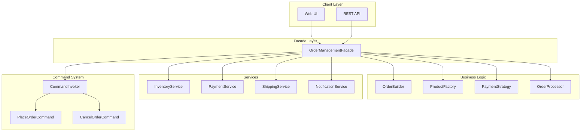

### Pattern Integration Flow

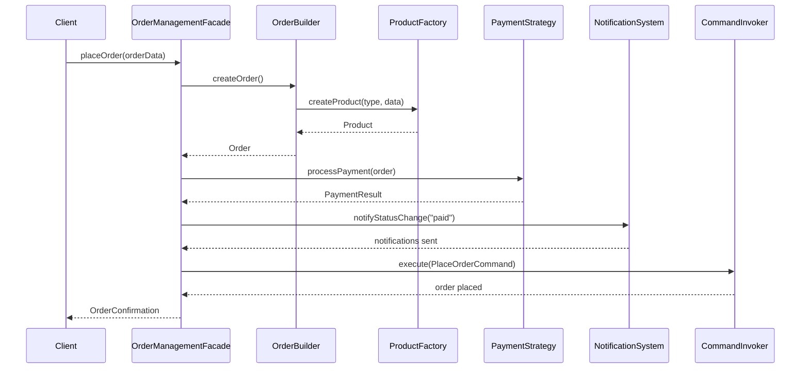

### Analysis and Pattern Selection

**Creational Patterns Needed**:

1. **Factory Pattern** for Product Creation:
```python
class ProductFactory: 
    @staticmethod
    def create_product(product_type, **kwargs):
        if product_type == "physical":
            return PhysicalProduct(**kwargs)
        elif product_type == "digital":
            return DigitalProduct(**kwargs)
        elif product_type == "subscription":
            return SubscriptionProduct(**kwargs)
```

2. **Builder Pattern** for Order Creation:
```python
class OrderBuilder:
    def __init__(self):
        self.order = Order()
    
    def add_product(self, product):
        self.order.products.append(product)
        return self
    
    def set_customer(self, customer):
        self.order.customer = customer
        return self
    
    def set_shipping_address(self, address):
        self.order.shipping_address = address
        return self
    
    def apply_discount(self, discount):
        self.order.discount = discount
        return self
```

**Structural Patterns Needed**:

1. **Decorator Pattern** for Order Processing:
```python
class OrderProcessorDecorator:
    def __init__(self, processor):
        self.processor = processor
    
    def process(self, order):
        return self.processor.process(order)

class TaxCalculatorDecorator(OrderProcessorDecorator):
    def process(self, order):
        result = self.processor.process(order)
        # Add tax calculation logic
        return result

class ShippingCalculatorDecorator(OrderProcessorDecorator):
    def process(self, order):
        result = self.processor.process(order)
        # Add shipping calculation logic
        return result
```

2. **Facade Pattern** for Order Management:
```python
class OrderManagementFacade:
    def __init__(self):
        self.inventory = InventoryService()
        self.payment = PaymentService()
        self.shipping = ShippingService()
        self.notification = NotificationService()
    
    def place_order(self, order):
        # Orchestrate all services
        self.inventory.reserve_items(order.products)
        payment_result = self.payment.process_payment(order)
        if payment_result.success:
            self.shipping.schedule_delivery(order)
            self.notification.send_confirmation(order)
        return payment_result
```

**Behavioral Patterns Needed**:

1. **Strategy Pattern** for Payment Processing:
```python
class PaymentProcessor:
    def __init__(self):
        self.strategy = None
    
    def set_payment_strategy(self, strategy):
        self.strategy = strategy
    
    def process_payment(self, order):
        return self.strategy.pay(order.total_amount)
```

2. **Observer Pattern** for Order Status Updates:
```python
class Order(Subject):
    def __init__(self):
        super().__init__()
        self._status = "pending"
    
    @property
    def status(self):
        return self._status
    
    @status.setter
    def status(self, new_status):
        self._status = new_status
        self.notify(f"Order status changed to {new_status}")
```

3. **Command Pattern** for Order Operations:
```python
class PlaceOrderCommand(Command):
    def __init__(self, order_service, order):
        self.order_service = order_service
        self.order = order
    
    def execute(self):
        return self.order_service.place_order(self.order)
    
    def undo(self):
        return self.order_service.cancel_order(self.order)
```

### Pattern Selection Decision Matrix

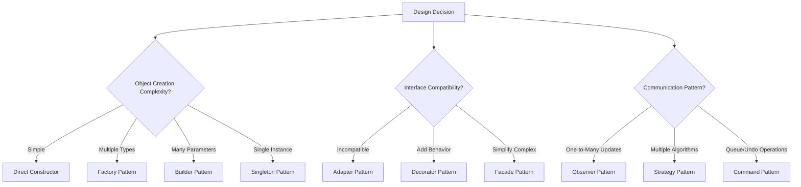

### Complete Integration Example:

```python
# Using multiple patterns together
def process_ecommerce_order():
    # Builder pattern for order creation
    order = (OrderBuilder()
             .set_customer(customer)
             .add_product(ProductFactory.create_product("physical", name="Laptop"))
             .add_product(ProductFactory.create_product("digital", name="Software"))
             .set_shipping_address(address)
             .build())
    
    # Strategy pattern for payment
    payment_processor = PaymentProcessor()
    payment_processor.set_payment_strategy(CreditCardPayment("1234567890"))
    
    # Observer pattern for notifications
    order.attach(EmailNotification())
    order.attach(SMSNotification())
    
    # Decorator pattern for processing
    processor = BasicOrderProcessor()
    processor = TaxCalculatorDecorator(processor)
    processor = ShippingCalculatorDecorator(processor)
    
    # Command pattern for execution
    command = PlaceOrderCommand(order_service, order)
    result = command.execute()
    
    # Facade pattern for coordination
    facade = OrderManagementFacade()
    return facade.place_order(order)
```

### Pattern Selection Reasoning Matrix:

| Pattern | Problem Solved | Why Chosen | Alternative Considered |
|---------|----------------|------------|----------------------|
| **Factory** | Different product types | Runtime type determination | Direct instantiation (too rigid) |
| **Builder** | Complex order creation | Many optional parameters | Constructor overloading (unwieldy) |
| **Strategy** | Payment methods | Runtime algorithm switching | If-else chains (hard to extend) |
| **Observer** | Notifications | Decoupled communication | Direct method calls (tight coupling) |
| **Decorator** | Order processing | Flexible responsibility chain | Inheritance (explosion of classes) |
| **Command** | Order operations | Undo/redo + queuing | Direct method calls (no undo) |
| **Facade** | System complexity | Simplified interface | Direct service calls (complex client) |

---

## Key Takeaways

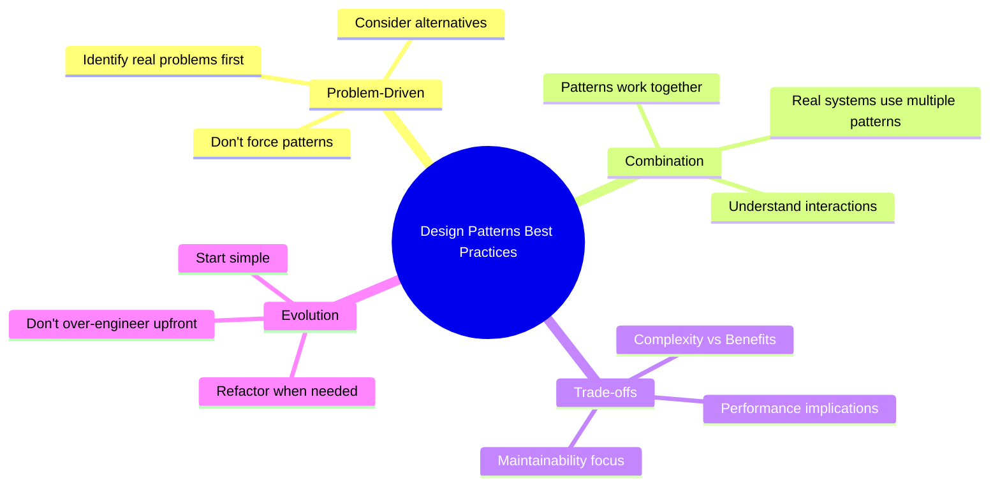

### Pattern Selection Guidelines:

1. **Choose patterns based on problems, not preferences**: Each pattern solves specific design problems
2. **Don't over-engineer**: Use patterns when they genuinely improve code quality
3. **Patterns work together**: Real systems often combine multiple patterns
4. **Focus on maintainability**: Patterns should make code easier to understand and modify
5. **Consider trade-offs**: Patterns add complexity but solve bigger problems

### Common Anti-Patterns to Avoid:

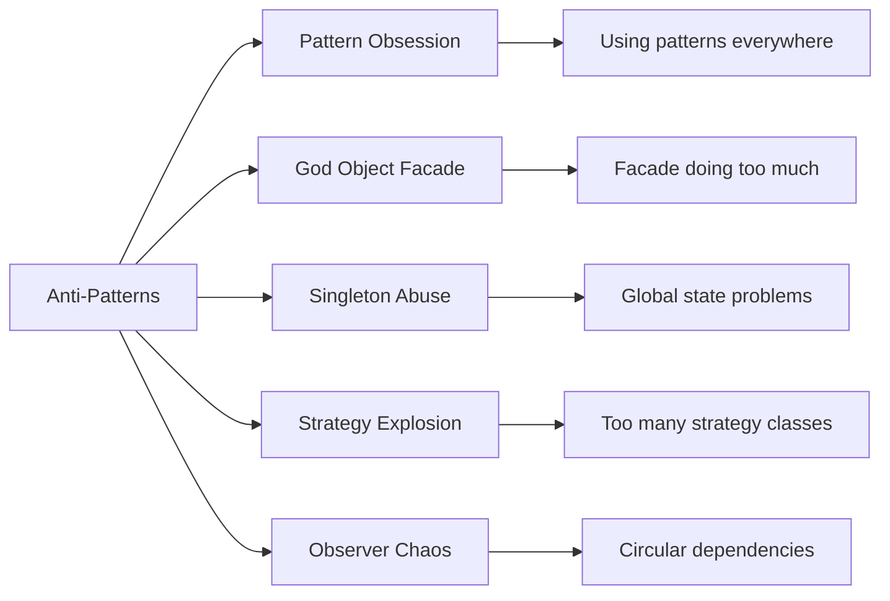

## Anti-Patterns: What NOT to Do

Anti-patterns are common responses to recurring problems that are usually ineffective and counterproductive. Understanding anti-patterns is as important as knowing design patterns.

### Design Pattern Anti-Patterns

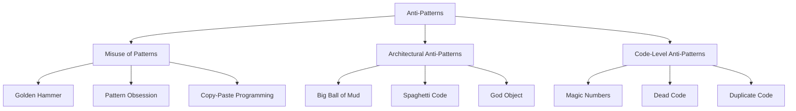

### 1. Pattern-Specific Anti-Patterns

#### Singleton Anti-Patterns
```python
# ❌ ANTI-PATTERN: Singleton Abuse
class ConfigManager:  # Everything becomes singleton
    _instance = None
    # ... singleton implementation

class DatabaseManager:  # Another singleton
    _instance = None
    # ... singleton implementation

class LogManager:  # Yet another singleton
    _instance = None
    # ... singleton implementation

# Problems: Global state, testing difficulties, tight coupling
```

```python
# ✅ BETTER APPROACH: Dependency Injection
class OrderService:
    def __init__(self, config, db, logger):
        self.config = config
        self.db = db  
        self.logger = logger
    
    def process_order(self, order):
        # Use injected dependencies
        pass
```

#### Factory Anti-Patterns
```python
# ❌ ANTI-PATTERN: God Factory
class EverythingFactory:
    def create_object(self, type, subtype, variant, options):
        if type == "user":
            if subtype == "admin":
                if variant == "super":
                    # 50 lines of creation logic
                elif variant == "regular":
                    # 30 lines of creation logic
            elif subtype == "regular":
                # ... more nested conditions
        elif type == "product":
            # ... another 100 lines
        # This factory does too much!
```

```python
# ✅ BETTER APPROACH: Specialized Factories
class UserFactory:
    def create_admin(self, level): pass
    def create_regular_user(self): pass

class ProductFactory:
    def create_physical_product(self): pass
    def create_digital_product(self): pass
```

### 2. Architectural Anti-Patterns

#### The God Object
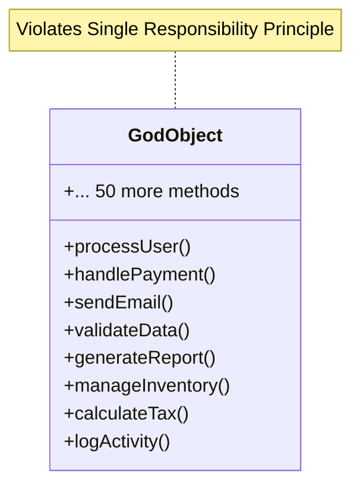

#### Big Ball of Mud
The "Big Ball of Mud" anti-pattern refers to a software architecture or system design characterized by a lack of structure, organization, and clear separation of concerns. In a Big Ball of Mud architecture, the codebase typically evolves over time without a coherent architectural vision or efficient design decisions. As a result, the system becomes increasingly complex, tangled, difficult to understand, maintain, and extend.
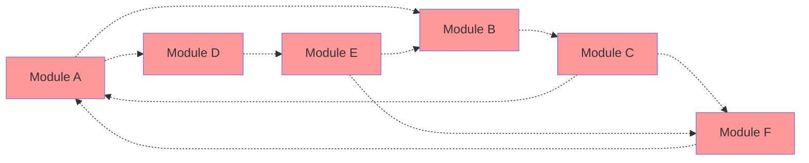

### 3. Common Design Anti-Patterns

#### Magic Numbers and Strings
```python
# ❌ ANTI-PATTERN: Magic Numbers
def calculate_discount(price):
    if price > 1000:
        return price * 0.15  # What does 0.15 mean?
    elif price > 500:
        return price * 0.10  # What does 0.10 mean?
    return 0

def get_user_type(code):
    if code == 1:  # What does 1 mean?
        return "admin"
    elif code == 2:  # What does 2 mean?
        return "user"
```

```python
# ✅ BETTER APPROACH: Named Constants
class DiscountRates:
    PREMIUM_THRESHOLD = 1000
    PREMIUM_RATE = 0.15
    STANDARD_THRESHOLD = 500
    STANDARD_RATE = 0.10

class UserTypes:
    ADMIN = 1
    REGULAR_USER = 2

def calculate_discount(price):
    if price > DiscountRates.PREMIUM_THRESHOLD:
        return price * DiscountRates.PREMIUM_RATE
    elif price > DiscountRates.STANDARD_THRESHOLD:
        return price * DiscountRates.STANDARD_RATE
    return 0
```

#### Copy-Paste Programming
```python
# ❌ ANTI-PATTERN: Duplicate Code
def process_order_email(order):
    subject = f"Order {order.id} Confirmation"
    body = f"Dear {order.customer.name}, your order has been processed"
    send_email(order.customer.email, subject, body)

def process_shipment_email(order):
    subject = f"Order {order.id} Shipped"  # Similar code
    body = f"Dear {order.customer.name}, your order has been shipped"  # Similar code
    send_email(order.customer.email, subject, body)  # Duplicate

def process_delivery_email(order):
    subject = f"Order {order.id} Delivered"  # Similar code again
    body = f"Dear {order.customer.name}, your order has been delivered"  # Similar code again
    send_email(order.customer.email, subject, body)  # More duplication
```

```python
# ✅ BETTER APPROACH: Template Method Pattern
class EmailNotification:
    def send_order_notification(self, order, event_type):
        subject = self._create_subject(order, event_type)
        body = self._create_body(order, event_type)
        send_email(order.customer.email, subject, body)
    
    def _create_subject(self, order, event_type):
        return f"Order {order.id} {event_type.title()}"
    
    def _create_body(self, order, event_type):
        messages = {
            'confirmation': 'has been processed',
            'shipped': 'has been shipped', 
            'delivered': 'has been delivered'
        }
        return f"Dear {order.customer.name}, your order {messages[event_type]}"
```

### 4. Anti-Pattern Detection Checklist

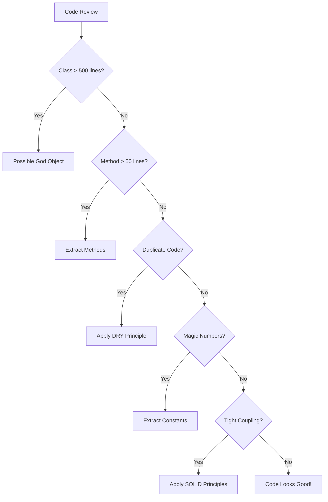

### 5. Refactoring Anti-Patterns

#### Before: Anti-Pattern Example
```python
class OrderProcessor:  # God Object Anti-Pattern
    def process_order(self, order_data):
        # Validation (should be separate)
        if not order_data.get('email'):
            raise ValueError("Email required")
        
        # Payment processing (should be separate)
        if order_data['payment_method'] == 'credit_card':
            # 20 lines of credit card logic
            pass
        elif order_data['payment_method'] == 'paypal':
            # 15 lines of PayPal logic
            pass
        
        # Inventory management (should be separate)
        for item in order_data['items']:
            # 10 lines of inventory logic
            pass
        
        # Email notification (should be separate)
        # 15 lines of email logic
        
        # Logging (should be separate)
        # 5 lines of logging logic
```

#### After: Proper Pattern Application
```python
class OrderProcessor:
    def __init__(self, validator, payment_processor, inventory, notifier, logger):
        self.validator = validator
        self.payment_processor = payment_processor
        self.inventory = inventory
        self.notifier = notifier
        self.logger = logger
    
    def process_order(self, order_data):
        self.validator.validate(order_data)
        payment_result = self.payment_processor.process(order_data)
        self.inventory.reserve_items(order_data['items'])
        self.notifier.send_confirmation(order_data)
        self.logger.log_order_processed(order_data)
        return payment_result
```

### Anti-Pattern Prevention Guidelines

1. **Single Responsibility**: Each class should have one reason to change
2. **Avoid Global State**: Minimize singletons and global variables
3. **Favor Composition**: Use dependency injection over inheritance
4. **Keep It Simple**: Don't over-engineer solutions
5. **Regular Refactoring**: Continuously improve code structure
6. **Code Reviews**: Have others review your pattern usage
7. **Test-Driven Development**: Write tests to catch design issues early

## Pattern Complexity Matrix

```mermaid
graph LR
    subgraph "Beginner Friendly"
        A1[Singleton]
        A2[Factory]
        A3[Facade]
    end
    
    subgraph "Intermediate"
        B1[Builder]
        B2[Adapter]
        B3[Strategy]
        B4[Observer]
    end
    
    subgraph "Advanced"
        C1[Decorator]
        C2[Command]
    end
    
    A1 --> B1
    A2 --> B2
    A3 --> B3
    B1 --> C1
    B2 --> C1
    B3 --> C2
    B4 --> C2
```

Remember: Design patterns are tools, not rules. Use them judiciously to solve real problems in your codebase.